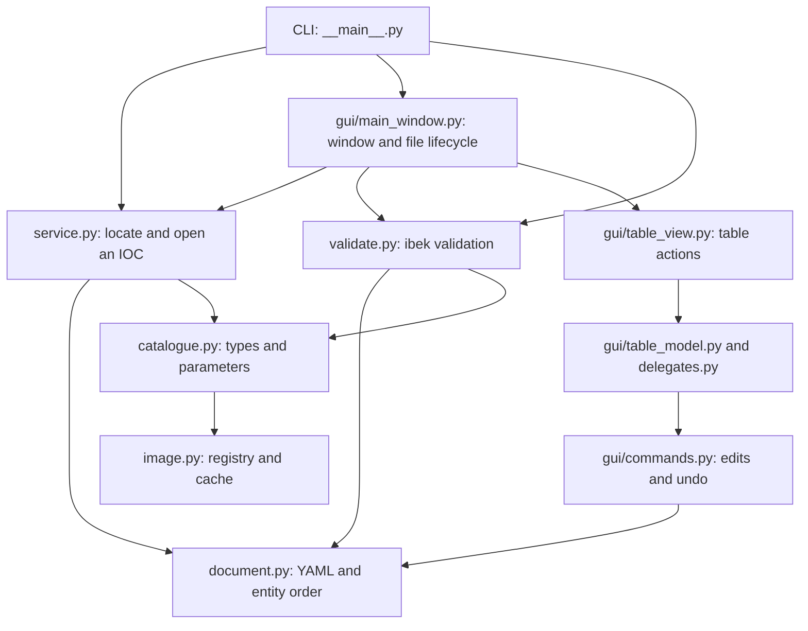
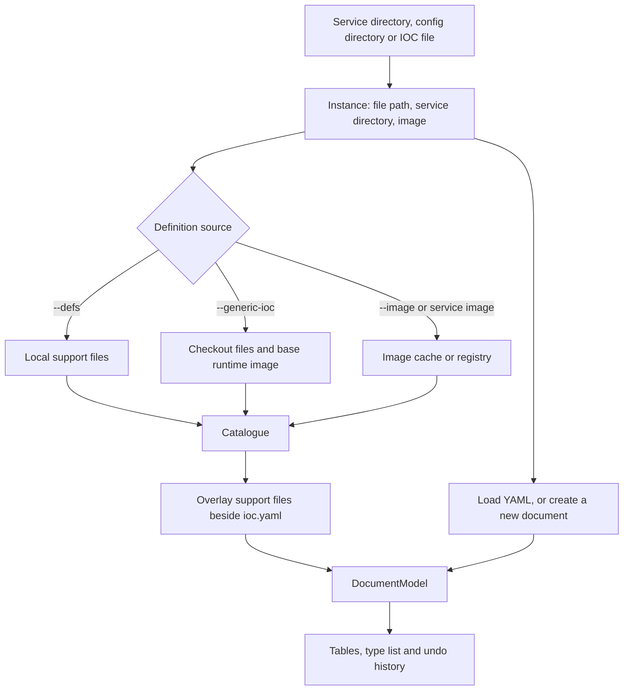
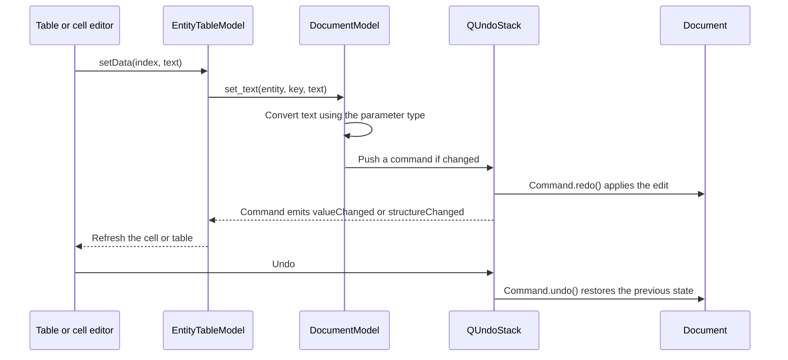

# Architecture

The editor has a Python core and a Qt interface. The core discovers entity
definitions, loads YAML and validates it. The interface presents tables and
records edits for undo. [The README](../README.md) explains how to use it.

## Main parts

Arrows show the main dependencies, not every import. **Only `gui/` imports Qt.**
The CLI imports the GUI when starting a window; reporting commands can run
without a display or Qt system libraries.

| Module | Responsibility |
| --- | --- |
| `service.py` | Resolve a target into an `Instance`; choose definitions; open or create a `Document` |
| `catalogue.py` | Parse support files through ibek into `Catalogue`, `EntityType` and `Param` objects |
| `image.py` | Read image manifests and layers; resolve definition symlinks; manage the cache |
| `document.py` | Own the round-trip YAML, entity order and commented state |
| `yaml_format.py` | Recognise commented entities and adjust ruamel separator tokens |
| `file_io.py` | Write a complete temporary file before atomically replacing its destination |
| `image_layers.py` | Merge support files and links across image layers, applying whiteouts |
| `table_text.py` | Encode clipboard text and increment cell text without importing Qt |
| `validate.py` | Build ibek's IOC model and return `Problem` objects |
| `gui/commands.py` | Own the `DocumentModel` and its `QUndoStack`; implement undoable changes |
| `gui/table_model.py` | Present one entity type as rows and parameters as columns |
| `gui/delegates.py` | Create text editors and drop-downs for cells |
| `gui/table_view.py` | Handle clipboard, fill, row actions and keyboard events |
| `gui/main_window.py` | Assemble the window; handle files, menus and problem navigation |

## Opening a document

`load_catalogue()` selects sources in this order: explicit definitions,
checkout, then image. Local support files replace modules with matching names.
Invalid support files and missing definition directories raise errors. Window
loading prepares the new instance, catalogue and document before replacing the
current state. Reload explicitly bypasses catalogue reuse without detaching
the current model.

Checkout discovery recognises the project's `ARG DEVELOPER`, `COPY` and
`RUN ansible.sh` conventions. It is a limited parser, not a Dockerfile build
engine. Failure to fetch the base image is an error; the editor keeps the current
document instead of opening a partial catalogue.

The registry client chooses linux/amd64 from a multi-platform index. It scans
layers oldest first, retaining support YAML and links in memory. Whiteouts and
opaque directories remove lower-layer entries; newer files replace older ones.
Relative link targets are normalised as container paths. Unresolved definition
links, link cycles, and a symlinked definitions directory produce errors.

Full layer scans cost more on the first fetch than the previous shortcut of
reading one layer. No arbitrary archive paths are extracted to the host; only
resolved support YAML is written to the cache.

Each image/tag has immutable snapshot directories and a `.current` pointer.
After a snapshot is complete, an atomic write switches the pointer. A failed
refresh keeps the old snapshot available. Old snapshots remain so catalogues
already open in another window or process still refer to valid paths. Metadata
records the manifest digest, format version and support filenames; missing
files invalidate a cache entry.

## Editing and undo

Keep these rules when adding features:

- Persistent GUI edits belong on the undo stack. Paste, fill and clear group
  their cell commands into one undo action. Adding an empty table is UI state
  and does not itself change the document.
- Find entity rows **by identity** (`is`, `index_of`, `row_of`). Two new entities
  can be equal dictionaries while representing different rows.
- `Document.entities` determines startup order. `DocumentModel.type_order`
  determines table order; regrouping synchronises them through an undo command.
- Structure changes reset table models. Drag handlers defer changes until Qt
  has finished handling its own move signal.
- The stack's clean marker tracks unsaved edits. Set it only after a successful
  write; clearing it prematurely can lose the unsaved-changes prompt.

## YAML and commented entities

`Document` holds ruamel `CommentedMap` and `CommentedSeq` objects so comments,
quotes and scalar styles can survive editing. Loading temporarily uncomments
recognised `# - type:` blocks and tracks their entities by object identity.
Serialisation dumps the YAML and comments those entities again.

Blank separators are stored in ruamel comment tokens attached to keys.
`yaml_format.normalise_separators()` adjusts those tokens after inserts and moves. This
couples the document code to ruamel's comment representation; keep it covered
with small before/after fixtures as well as the full IOC example.

The serializer writes the whole document and uses a fixed indentation style.
Exact text preservation is tested for the example fixture, not guaranteed for
all YAML layouts. The comment pass uses the emitter's indentation rather than
the original file's indentation, so disabled entities stay disabled after saving.
Malformed entity collections and non-mapping entities are rejected on load.
Missing or null `entities` means an empty IOC.

## Validation

`Document.plain()` produces ordinary Python data without commented entities.
Validation builds models using ibek's `EntityFactory` and `IocFactory`, then
maps errors to `Problem(entity, field, message)`. Entity positions are mapped
back to the full document, including commented rows.

The validation adapter serialises calls with a lock, clears ibek's ID registry
before and after model construction/validation, and restores the prior IOC name
even after failures. It captures stdout and suppresses deprecation warnings
while invoking ibek. Stdout and warning handling still affect the process; use
a separate process if validation must run alongside unrelated ibek operations.

The Problems panel stores positions from the last validation. Edits clear
these results and highlights, so navigation cannot use stale positions.

## Where to make a change

| Change | Start here | Tests to extend |
| --- | --- | --- |
| File discovery or definition precedence | `service.py` | `test_service.py` |
| A new definition source | `catalogue.py`, then `service.py` | `test_catalogue.py` |
| Authentication, layers or cache | `image.py` | `test_image.py` |
| YAML preservation or value conversion | `document.py` | `test_document.py` |
| A new undoable operation | `gui/commands.py` | `test_gui.py` |
| Cell editing or presentation | Table model and delegates | `test_gui.py` |
| Validation mapping | `validate.py` | `test_validate.py` |

See [development and testing](development.md) for commands.
