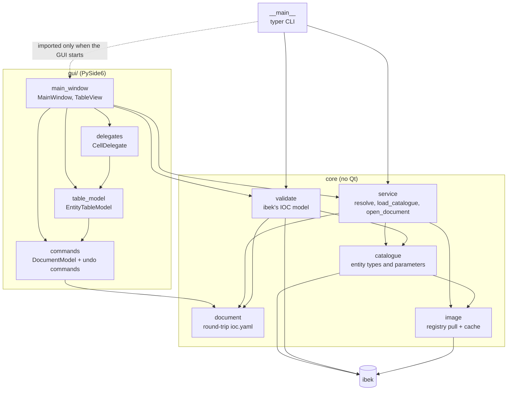
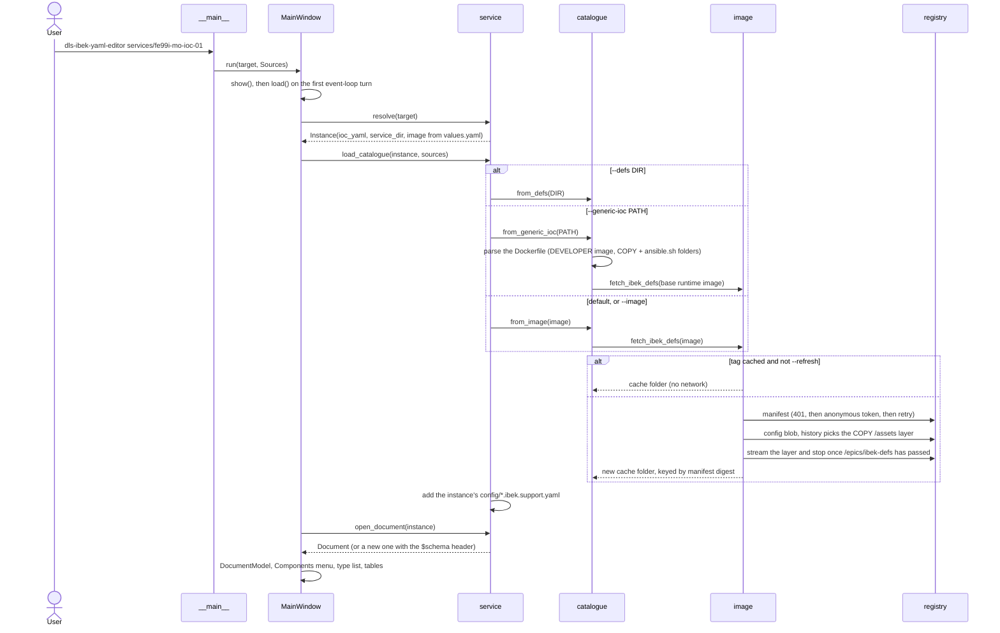
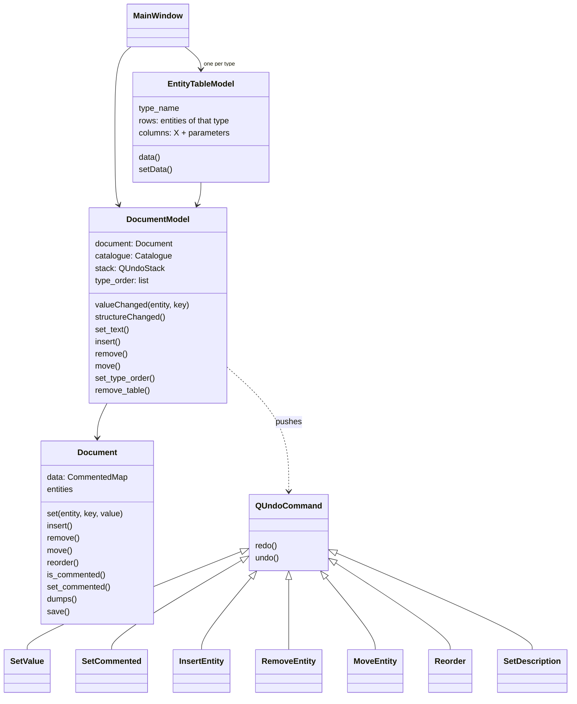
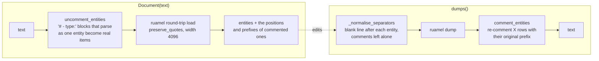

# How the code is organised

This page is for anyone changing the tool. The [README](../README.md) covers
using it.

## Module map



The rule that matters: **nothing outside `gui/` imports Qt.** That is why
`--list-entities`, `--validate` and most of the tests run with no display or
libGL. `__main__` imports the GUI inside the function that starts it. If Qt
can't load, it reports that and exits.

| Module | Job |
|---|---|
| `image` | Turns an image reference into a local folder of `*.ibek.support.yaml`. It talks to the registry over the OCI API, using only the standard library, and keeps a cache. |
| `catalogue` | Parses support YAML with ibek's own `Support` model into `EntityType` and `Param` objects. Its builders are `from_defs`, `from_image` and `from_generic_ioc`. |
| `document` | Holds the `ioc.yaml` in ruamel round-trip form and provides the edits (set, insert, remove, move, regroup, comment out). |
| `service` | Ties a service directory to its image, its catalogue and its document. |
| `validate` | Runs the document through ibek's generated pydantic IOC model and maps errors back to entities and fields. |
| `gui/commands` | `DocumentModel`: the only way the GUI changes a document, through `QUndoCommand`s. |
| `gui/table_model` | Shows one entity type as a Qt table. |
| `gui/delegates` | The cell editors: combos for enums, bools and object references. |
| `gui/main_window` | The xeb-style window, its menus, the clipboard, Fill and Fill and Increment. |

## Start-up



Points to know:

- **Entities come from the image, not the checkout.** A generic IOC
  inherits modules from its base image. For example, iocStats in
  ioc-dlsmotorplc comes from `ioc-asyn-developer`. Those modules are in the
  runtime image's `/epics/ibek-defs` but not in the generic IOC's
  Dockerfile. `--generic-ioc` handles this by pulling the base image for
  them.
- **`/epics/ibek-defs/*.yaml` are symlinks** into
  `/epics/generic-source/...`, which comes earlier in the same layer.
  `_scan_layer` keeps every support YAML it passes, then resolves the links.
- **A cached tag skips the network.** Release tags don't change, and some
  workstations can't reach the registry. `--refresh` asks the registry
  anyway, and a `latest` tag is always checked.

## How an edit flows



```mermaid
sequenceDiagram
    participant V as TableView / CellDelegate
    participant T as EntityTableModel
    participant M as DocumentModel
    participant U as QUndoStack
    participant D as Document

    V->>T: setData(index, "1e-05")
    T->>M: set_text(entity, "MRES", "1e-05")
    M->>M: convert the text with the parameter's type; ignore if unchanged
    M->>U: push(SetValue)
    U->>D: SetValue.redo() → set(entity, key, value)
    U-->>M: valueChanged(entity, key)
    M-->>T: valueChanged → dataChanged for that cell
```

Rules that keep this working:

- **Every change goes through `DocumentModel` and the undo stack.** Undo,
  redo and the "modified" title mark all depend on it. Fill, paste and
  clear are undo macros of single-cell edits.
- **Entities are found by identity, never by equality.** Two new entities
  of the same type are equal dicts. Use `row_of`, `index_of` and `is`, never
  `in` or `.index()` on lists of entities.
- **Changes to the order** emit `structureChanged`, and every table rebuilds.
  Drag and drop handlers schedule the change with `QTimer.singleShot`,
  because changing the model while Qt is still handling its own drop
  signal is unsafe.
- **Grouped by type, as in xeb.** The type list order *is* the file order,
  so moving a table regroups `entities` (`Reorder`). ibek needs an entity to
  come before anything that refers to its id. Validation catches an `object`
  reference that comes too early. Plain string links such as `port:` are not
  checked, by ibek or here.

## Loading and saving `ioc.yaml`



- **An unedited file saves byte-identical,** and tests check that for
  fe99i. That's the basis for "saving changes only the lines you edited",
  so check it whenever this code changes.
- **Blank lines between entities** are stored by ruamel as a comment token
  on the *last key* of the entity before them. Adding a key at the end or
  moving an entity would move that blank line, so `_normalise_separators`
  puts it back on each entity's last key.
- **Commented-out entities are YAML comments, not `entity_enabled: false`.**
  That matches xeb and how people comment out entities by hand. While the
  file is open they are real entities, so they can still be edited.
  `plain()`, which feeds validation, and `ids()`, which feeds the reference
  drop-downs, both leave them out.

## Validation

`validate.validate` builds ibek's models from the catalogue's support files
(`EntityFactory.make_entity_models`, then `IocFactory.make_ioc_model`). It
then validates `document.plain()` and turns each pydantic error location
`entities, <n>, <type>, <field>` into a `Problem` for that entity and field.
Because commented entities are left out, `<n>` is mapped back to the
entity's position in the whole file. ibek prints while it works and gives a
pydantic deprecation warning, so both are silenced. ibek's global id
registry is cleared before and after each run.

## Packaging constraints

- **Python ≥ 3.13,** because ibek ≥ 4.7 requires it.
- **`pyside6-essentials` < 6.10.** Wheels from 6.10 on need glibc 2.34, and
  RHEL 8 has 2.28.
- **No docker or podman.** The registry is read with `urllib` and
  `truststore`, which uses the OS certificate store, as ibek does.

## Tests

- **Data:** `tests/data` holds a copy of fe99i, a snapshot of the image's
  support YAML and a Dockerfile.
- **Registry tests** use a fake registry made from in-memory tar layers.
  `DLS_IBEK_YAML_EDITOR_LIVE=1` adds one test against the real registry.
- **GUI tests** (`tests/test_gui.py`) run with `QT_QPA_PLATFORM=offscreen`,
  and skip themselves when Qt can't load.
